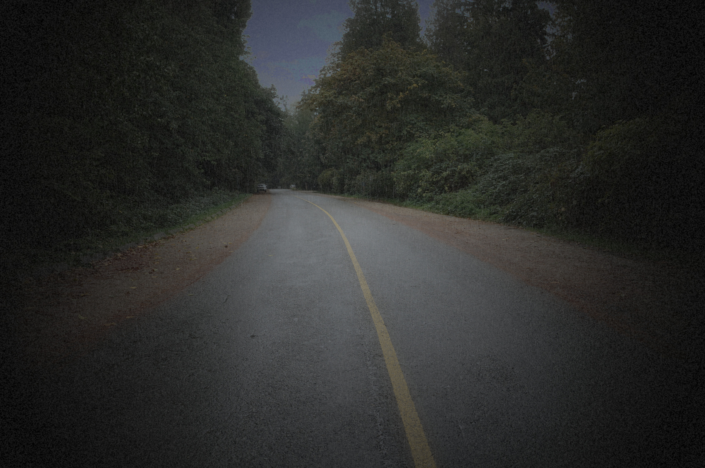
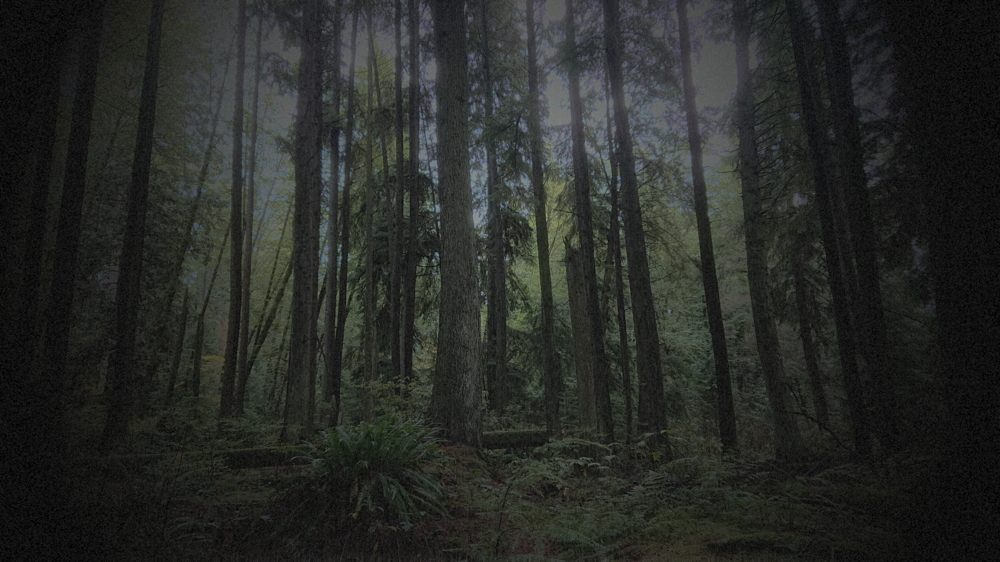
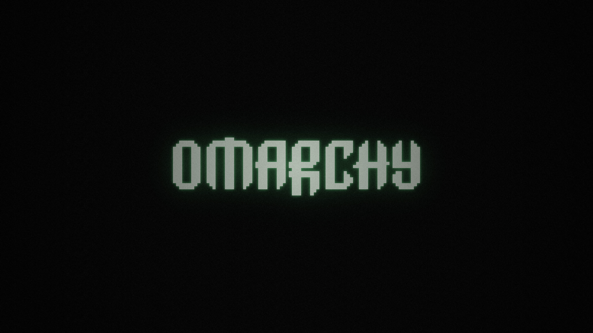
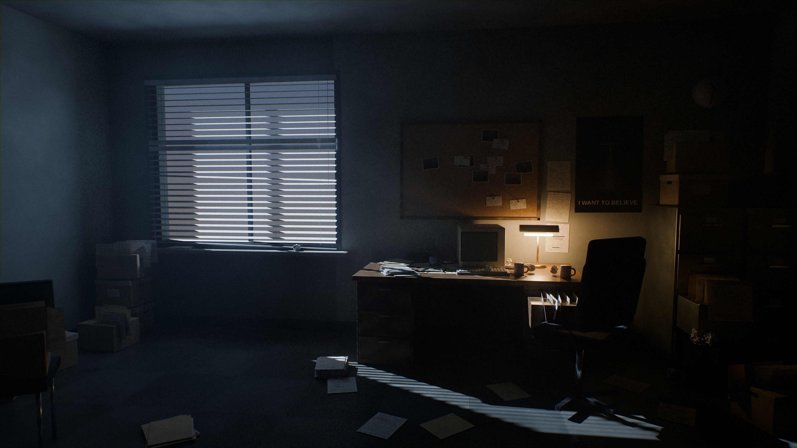

# I Want To Believe

A dark, quiet [Omarchy](https://omarchy.org) theme in cold teal rain and forest fog, built around photographs from wet Pacific Northwest woods. The truth is out there — usually in a mossy fir forest at dusk, with the light failing and the drizzle thickening.


## Install

```bash
omarchy theme install https://github.com/dmcarrington/omarchy-i-want-to-believe-theme
```

Reapply it later with:

```bash
omarchy theme set i-want-to-believe
```

## Included

- `colors.toml` — the full palette: deep spruce background, fog-grey text, an overcast teal accent, and an active window border that fades from rain teal into steel storm blue.
- `icons.theme` — `Yaru-prussiangreen` icons.
- `backgrounds/` — four 3840px wallpapers: two graded rain-forest photographs, the Omarchy wordmark, and a path-traced office scene. Cycle them with `omarchy theme bg next`.
- `preview.jpg` — the theme picker preview.
- `unlock.png`, `preview-unlock.png` — the boot and login screen logo: the Omarchy wordmark in pale green-white with a phosphor-green glow, carrying the same film grain and mild TV static as the wordmark wallpaper. Pick it under Style → Unlock.
- `shell.toml` — Omarchy shell surfaces, rendered from the palette, with a lock screen to match: a near-black password card, a quiet spruce border at rest, rain teal while typing, and red on a wrong password.

Omarchy generates the Hyprland, terminal, and editor files from `colors.toml`. The repository ships no Lua, terminal configs, or `vscode.json`, so a Git-installed copy looks the same as the original.

## Palette

| Role | Colour |
| --- | --- |
| Background | `#111715` |
| Foreground | `#c5d0c9` |
| Accent | `#6fb3a4` |
| Green | `#83b583` |
| Cyan | `#71bfb2` |
| Blue | `#7ba3bd` |
| Magenta | `#ab92b4` |
| Yellow | `#d8bd84` |
| Red | `#cf7368` |

Cold-teal shadows and fog-grey tones keep the desktop easy on the eyes for long sessions. The brighter members of the palette borrow from the show's props: Mulder's flashlight beam for `yellow`, Scully's auburn for `orange`, a redacted FBI folder for `red`.

## Wallpapers

The forest wallpapers were photographed in Pacific Northwest rain forest, then darkened and desaturated into an overcast teal cast, their highlights swallowed by fog, two screens of rain streaks laid over the frame, and a film grain and vignette to finish.

`4-office-night.jpg` is path-traced in Blender Cycles — a cramped basement office at 3 a.m., built as real geometry. Cold moonlight slants through a window of venetian blinds (a couple of slats bent), hangs in the dusty air as a visible shaft, and lays striped bars across the floor and the edge of the desk. The desk is pushed against the back wall under a corkboard of pinned surveillance photos and index cards joined with red string, lit only by a green banker's lamp beside a beige CRT, coffee mugs, and drifts of typed FBI pages. Banker boxes are stacked under the window and on the filing cabinets, a drawer hangs open with files sticking up, papers are scattered across the linoleum, and an "I WANT TO BELIEVE" poster waits in the gloom.

`3-omarchy.jpg` is the wordmark the stock themes ship, relit in the X-Files title-card palette: pale green-white letters with a phosphor-green glow on near-black, finished with a soft vignette and film grain across the whole frame.

| | |
| --- | --- |
|  |  |
|  |  |

*The shadows were where... the secrets kept themselves, and the rain erased the evidence.*
